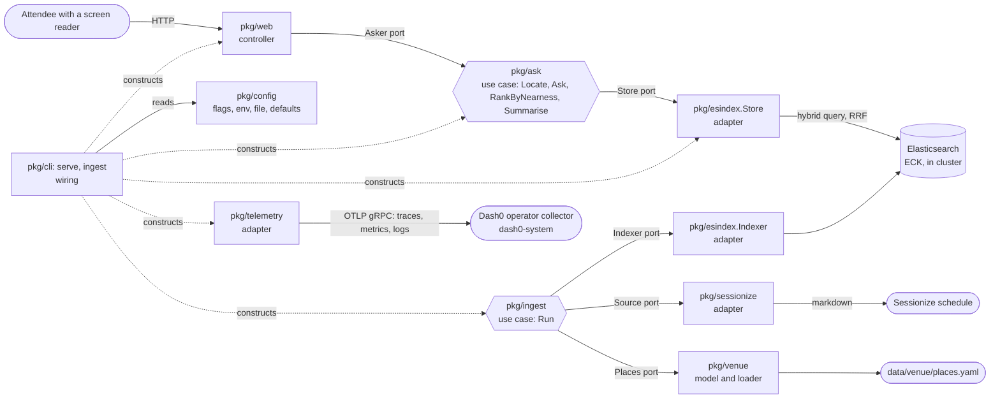

# Wide Door, how it is built

One Go module, four layers, every import pointing inward.
The use case in the middle says what it needs; everything around it either asks it questions or answers them.

## Packages, one line each

| package | layer | what it is for |
| --- | --- | --- |
| `pkg/ask` | use case, and the model types | answers "where is the nearest X from here": resolves the room, searches, ranks by level then building, writes the one sentence a screen reader hears first |
| `pkg/ingest` | use case | fills the store: fetches the schedule through its `Source`, loads the curated places through `Places`, writes both through `Indexer`, and reports what was rejected |
| `pkg/venue` | model | the curated access features (`data/venue/places.yaml`), the rooms derived from the schedule, and the loader that validates them |
| `pkg/schedule` | model | a conference session as the app sees it, whatever the source |
| `pkg/config` | model | every setting named once: `Key*` constants, defaults, flag binding, and the typed `Server`, `Elasticsearch`, `Ingest` and `Telemetry` interfaces each layer takes |
| `pkg/esindex` | adapter | everything Elasticsearch: the HTTP client, `Store` (the hybrid BM25 plus `semantic_text` query fused with RRF, the room lookup, hit parsing) and `Indexer` (both index mappings, document shapes, bulk writes) |
| `pkg/sessionize` | adapter | fetches and parses the public KubeCon schedule from Sessionize's markdown view |
| `pkg/telemetry` | adapter | everything OpenTelemetry: `Setup` builds the SDK providers and OTLP gRPC exporters (noops when no endpoint is set), `Handler` is the slog handler that sends every log line to Dash0 with its trace id, `Transport` makes each Elasticsearch call a child span |
| `pkg/web` | controller | the HTML page, the JSON API, the probes, the templates and the CSS |
| `pkg/cli` | wiring | the `widedoor` command and its `serve` and `ingest` subcommands: load config, construct adapters, hand them to the use cases |
| `pkg/app` | wiring | `Main()`: builds the command line and turns its result into an exit code |
| `cmd/widedoor` | wiring | `os.Exit(app.Main())` |

## Ports, one line each

| port | declared by | implemented by | why it exists |
| --- | --- | --- | --- |
| `ask.Store` (`LocateRoom`, `FindPlaces`, `FindSessions`) | `pkg/ask` | `esindex.Store` | the use case asks for rooms, places and sessions in its own words; the query language stays in the adapter, and `Ask` is tested with a ten-line fake |
| `web.Asker` (`Ask`, `Locate`) | `pkg/web` | `ask.Service` | the page needs answers, not a search engine; handler tests pass a fake |
| `ingest.Source` (`Index`, `Describe`) | `pkg/ingest` | `sessionize.Client` | where the schedule comes from; a fake returns three sessions in the tests |
| `ingest.Places` (`Places`) | `pkg/ingest` | `venue.File` | where the curated features come from |
| `ingest.Indexer` (`EnsureIndexes`, `IndexSessions`, `IndexPlaces`) | `pkg/ingest` | `esindex.Indexer` | the store's write side, so the ingest use case never sees a mapping or a bulk body |
| `config.Server`, `config.Elasticsearch`, `config.Ingest`, `config.Telemetry` | `pkg/config` | `config.Configuration` over viper | each layer takes the slice of settings it needs; a test passes a struct |

Each port is declared by the package that uses it, not the one that implements it.
That is the whole trick: dependencies point at interfaces owned by the caller, so the caller never depends on the callee's implementation.

## Commands, one line each

| command | wires |
| --- | --- |
| `widedoor serve` | `esindex.Client` into `esindex.Store`, into `ask.Service`, into `web.New`, behind an `http.Server` on `server.listen` |
| `widedoor ingest` | `sessionize.Client` as `Source`, `venue.File` as `Places`, `esindex.Indexer` as `Indexer`, into `ingest.Runner.Run`; exit 2 when the store rejected documents |

One binary, one image; the Rollout runs it with `serve`, the CronJob with `ingest`.
Settings come from flags, then `WIDEDOOR_*` environment variables, then `/etc/widedoor/config.yaml` (the `widedoor-config` ConfigMap in the cluster), then defaults; the Elasticsearch password only from the environment or the file.

## Where to look when

| you want to change | look in |
| --- | --- |
| how answers are ranked, or the sentence a screen reader hears | `pkg/ask` (`RankByNearness`, `Summarise`) |
| the Elasticsearch query, the retrievers, which fields are searched | `pkg/esindex/store.go` |
| what is indexed and how it is mapped | `pkg/ingest` (the steps), `pkg/sessionize` (what is fetched), `pkg/esindex/index.go` (mappings and document shapes) |
| a setting's name, default or where it is read from | `pkg/config/config.go`; in the cluster, `deploy/app/config.yaml` |
| the curated places or how "nearest" knows levels | `data/venue/places.yaml`, `pkg/venue` |
| the page, the form, the live region, the CSS | `pkg/web` |
| what runs in the cluster, probes, resources, routes | `deploy/app` (synced by Argo CD, pinned by image SHA, bumped by `tools/bump-image.sh`) |
| which spans, metrics and logs leave the app, and where they go | `pkg/telemetry` (providers, exporters, the slog bridge), `pkg/ask/telemetry.go` and `pkg/ingest/telemetry.go` (the instruments and attribute names), `telemetry.otlp_endpoint` in `deploy/app/config.yaml` (the Dash0 operator's collector) |
| the platform under it (gateway, ECK, Argo, Dash0, Radar) | `infra/platform` (Terraform, built before kickoff) |

## The rule, and the check

The rule is in [`.gitar/review/architecture.md`](../.gitar/review/architecture.md): model and use case import nothing from this module, adapters may import the model, controllers import use cases and adapters, and nobody imports a controller.
`tools/archcheck.sh` reads the import graph with `go list` and fails CI with the offending edge named, so the rule cannot drift from the code without a red check.
A new package has to be placed in a layer in that script and get a line on this page before CI goes green.
