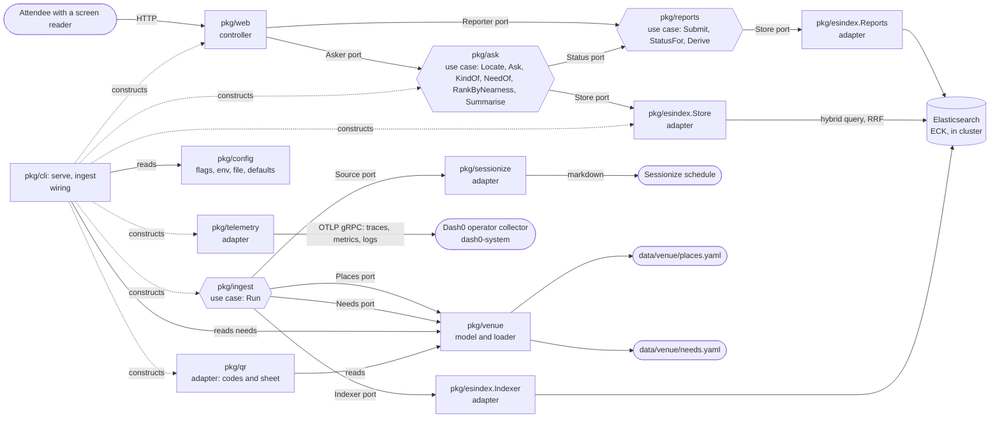
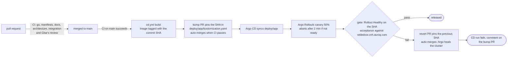

# Wide Door, how it is built

One Go module, four layers, every import pointing inward.
The use case in the middle says what it needs; everything around it either asks it questions or answers them.

## Packages, one line each

| package | layer | what it is for |
| --- | --- | --- |
| `pkg/ask` | use case, and the model types | answers "where is the nearest X from here": resolves the room, infers the kind of place asked for, asks the store for that kind, ranks by level then building, writes the one sentence a screen reader hears first |
| `pkg/reports` | use case | takes "Were you here?" reports: validates the verdict and note, rate limits per token and per IP, stores through its `Store`, and derives each place's attendee status (a problem shows at once, two different attendees make it verified, six hours and it is forgotten) |
| `pkg/ingest` | use case | fills the store: fetches the schedule through its `Source`, loads the curated places through `Places`, writes both through `Indexer`, and reports what was rejected |
| `pkg/model` | model | `Place`, `Room`, `Session`, `Here`, `Need`, `Answer`: what the business means, spoken by every port |
| `pkg/api/v1` | contract | the frozen JSON of `/api/ask`; a wire change is a `v2` |
| `pkg/venue` | model helper | the curated access features (`data/venue/places.yaml`) as model places, the need vocabulary (`data/venue/needs.yaml`) as model needs, the rooms derived from the schedule, and the loaders that validate them |
| `pkg/schedule` | model helper | schedule-wide helpers over `model.Session` |
| `pkg/config` | model | every setting named once: `Key*` constants, defaults, flag binding, and the typed `Server`, `Elasticsearch`, `Ingest` and `Telemetry` interfaces each layer takes |
| `pkg/esindex` | adapter | everything Elasticsearch: the HTTP client, `Store` (the hybrid BM25 plus `semantic_text` query fused with RRF, the room lookup, hit parsing) and `Indexer` (both index mappings, document shapes, bulk writes) |
| `pkg/sessionize` | adapter | fetches and parses the public KubeCon schedule from Sessionize's markdown view |
| `pkg/telemetry` | adapter | everything OpenTelemetry: `Setup` builds the SDK providers and OTLP gRPC exporters (noops when no endpoint is set), `Handler` is the slog handler that sends every log line to Dash0 with its trace id, `Transport` makes each Elasticsearch call a child span |
| `pkg/qr` | adapter | renders the code taped beside a door: the `/?from=<place id>` URL as SVG and PNG per place, and the printable sheet with the name in large type |
| `pkg/web` | controller | the HTML page, the JSON API, the probes, the templates and the CSS |
| `pkg/cli` | wiring | the `widedoor` command and its `serve`, `ingest` and `qr` subcommands: load config, construct adapters, hand them to the use cases |
| `pkg/app` | wiring | `Main()`: builds the command line and turns its result into an exit code |
| `cmd/widedoor` | wiring | `os.Exit(app.Main())` |

## Ports, one line each

| port | declared by | implemented by | why it exists |
| --- | --- | --- | --- |
| `ask.Store` (`LocateRoom`, `LocateRoomFuzzy`, `LocateAlias`, `LocateSession`, `LocateNearby`, `FindPlaces`, `FindSessions`, `FindNeeds`) | `pkg/ask` | `esindex.Store` | the use case asks for rooms, places, sessions and the need a paraphrase means, in its own words, and `Locate` tries the lookups in a fixed order (exact room, alias, session title, fuzzy room, semantic); the query language stays in the adapter, and `Ask` is tested with a ten-line fake |
| `ask.Status` (`StatusFor`) | `pkg/ask` | `reports.Service` | the answer says what attendees reported about each place in the same breath as verified or unverified; nil means nobody can report yet |
| `reports.Store` (`Save`, `Since`, `PlaceKind`) | `pkg/reports` | `esindex.Reports` | the reports index and the place lookup, in the use case's words; tested with a ten-line fake |
| `web.Reporter` (`Submit`) | `pkg/web` | `reports.Service` | the form hands over a submission and gets back a reason it can turn into a sentence; handler tests pass a fake |
| `web.Asker` (`Ask`, `Locate`) | `pkg/web` | `ask.Service` | the page needs answers, not a search engine; handler tests pass a fake |
| `ingest.Source` (`Index`, `Describe`) | `pkg/ingest` | `sessionize.Client` | where the schedule comes from; a fake returns three sessions in the tests |
| `ingest.Places` (`Places`) | `pkg/ingest` | `venue.File` | where the curated features come from |
| `ingest.Needs` (`Needs`) | `pkg/ingest` | `venue.NeedsFile` | where the need vocabulary comes from; `serve` reads the same file for the exact-phrase step |
| `ingest.Indexer` (`EnsureIndexes`, `IndexSessions`, `IndexPlaces`, `IndexNeeds`) | `pkg/ingest` | `esindex.Indexer` | the store's write side, so the ingest use case never sees a mapping or a bulk body |
| `config.Server`, `config.Elasticsearch`, `config.Ingest`, `config.Venue`, `config.Telemetry` | `pkg/config` | `config.Configuration` over viper | each layer takes the slice of settings it needs; a test passes a struct |

Each port is declared by the package that uses it, not the one that implements it.
That is the whole trick: dependencies point at interfaces owned by the caller, so the caller never depends on the callee's implementation.

## Commands, one line each

| command | wires |
| --- | --- |
| `widedoor serve` | `esindex.Client` into `esindex.Store`, into `ask.Service`, into `web.New`, behind an `http.Server` on `server.listen` |
| `widedoor ingest` | `sessionize.Client` as `Source`, `venue.File` as `Places`, `venue.NeedsFile` as `Needs`, `esindex.Indexer` as `Indexer`, into `ingest.Runner.Run`; exit 2 when the store rejected documents |
| `widedoor reports` | `esindex.Reports` into `list` (recent reports, newest first, never the token) and `hide ID` (stops a report counting) for volunteers |
| `widedoor qr` | `venue.File` and the rooms `sessionize.Client` names, into `qr.Codes.Write`: one SVG and PNG per place under `--out`, and `sheet.html` with `--sheet` |

One binary, one image; the Rollout runs it with `serve`, the CronJob with `ingest`.
Settings come from flags, then `WIDEDOOR_*` environment variables, then `/etc/widedoor/config.yaml` (the `widedoor-config` ConfigMap in the cluster), then defaults; the Elasticsearch password only from the environment or the file.

## Where to look when

| you want to change | look in |
| --- | --- |
| how answers are ranked, which kind a question asks for, or the sentence a screen reader hears | `pkg/ask` (`KindOf`, `RankByNearness`, `Summarise`) |
| what a phrase means: which kinds of place to offer for what someone says, and the note that goes with a stand-in | `data/venue/needs.yaml`; the order of the steps is `pkg/ask/need.go` (`placesFor`), the semantic fallback's threshold is `ask.MinNeedScore` |
| the Elasticsearch query, the retrievers, which fields are searched | `pkg/esindex/store.go` |
| what is indexed and how it is mapped | `pkg/ingest` (the steps), `pkg/sessionize` (what is fetched), `pkg/esindex/index.go` (mappings and document shapes) |
| a setting's name, default or where it is read from | `pkg/config/config.go`; in the cluster, `deploy/app/config.yaml` |
| the curated places or how "nearest" knows levels | `data/venue/places.yaml`, `pkg/venue` |
| the page, the form, the live region, the CSS | `pkg/web` |
| the "Were you here?" form, the `wd_id` cookie, the sentence after a report | `pkg/web/report.go`, `pkg/web/templates/report.html`; the trust rules are `reports.Derive`, the wording is `ask.AttendeeSentence`, the blocked words are `data/venue/blocked-words.txt` |
| a field in the JSON API, or what a type means | `pkg/api/v1` (the promise), `pkg/model` (the meaning), the adapter (the storage) |
| the QR codes on the doors, which places get one, the printable sheet | `pkg/qr`; the URL they open is `/?from=<place id>`, read by `pkg/web` and resolved id-first by `pkg/ask` |
| what runs in the cluster, probes, resources, routes | `deploy/app` (synced by Argo CD, pinned by image SHA, bumped by `tools/bump-image.sh` or by `cd.yml`) |
| how a release is built, pinned, checked and rolled back | `.github/workflows/cd.yml`, `tools/wait-pr.sh`, `tools/wait-rollout.sh`, `tools/smoke.sh`, ADR 0008 |
| which spans, metrics and logs leave the app, and where they go | `pkg/telemetry` (providers, exporters, the slog bridge), `pkg/ask/telemetry.go` and `pkg/ingest/telemetry.go` (the instruments and attribute names), `telemetry.otlp_endpoint` in `deploy/app/config.yaml` (the Dash0 operator's collector) |
| the platform under it (gateway, ECK, Argo, Dash0, Radar) | `infra/platform` (Terraform, built before kickoff) |

## Where a type lives

Three homes, and one sentence says which:

| home | the sentence | holds | may import |
| --- | --- | --- | --- |
| `pkg/model` | "it is what the business means" | `Place`, `Room`, `Session`, `Here`, `Answer`; every port speaks these | nothing in this module |
| the adapter that owns it | "it is how this adapter stores or reads it" | the YAML file shape in `pkg/venue`, the Elasticsearch documents and `semantic_text` content in `pkg/esindex`, the markdown rows in `pkg/sessionize`; private, mapped at the boundary | `pkg/model` |
| `pkg/api/v1` | "it is what clients were promised" | `AskResponse`, `Here`, `Place`, `Session`, `Error`, field names frozen; `pkg/web` maps the model onto it and is the only importer | nothing in this module |

`pkg/ask`, `pkg/venue` and `pkg/schedule` keep their old type names as aliases of the model types, so the code reads as before with one definition behind it.
`pkg/web/contract_test.go` compares `/api/ask`'s encoding with a response recorded before the move, byte for byte ([ADR 0011](adr/0011-types-live-by-kind.md)).

## How a change reaches production

Two workflows, by design ([ADR 0008](adr/0008-ci-cd-separation-and-rollback-by-revert.md)): `ci.yml` is what the required checks run, on every PR and on `main`; `cd.yml` starts only when CI on `main` succeeds and never on a PR.
Every change to `main`, bumps and reverts included, arrives through a pull request, so `git log main` is the release history.
The gate runs as the `cd-gate` ServiceAccount, which can read rollouts, replicasets and pods in `wide-door` and nothing else; its kubeconfig is built by `infra/platform` and stored as a repository secret.
Radar watches the cluster the whole time and lists a stalled Rollout as a live issue, correlated to the change that caused it; [`docs/demo/2026-11-09-rollout-abort.md`](demo/2026-11-09-rollout-abort.md) is one such event, captured live.

## The rule, and the check

The rule is in [`.gitar/review/architecture.md`](../.gitar/review/architecture.md): model and use case import nothing from this module, adapters may import the model, controllers import use cases and adapters, and nobody imports a controller.
`tools/archcheck.sh` reads the import graph with `go list` and fails CI with the offending edge named, so the rule cannot drift from the code without a red check.
A new package has to be placed in a layer in that script and get a line on this page before CI goes green.
The OpenTelemetry API packages (`go.opentelemetry.io/otel`, `.../trace`, `.../metric`, `.../attribute`, `.../codes`) and `otelhttp` are instrumentation vocabulary like the standard library and may be used in any layer; the SDK, the exporters and the log bridge live only in `pkg/telemetry`.
