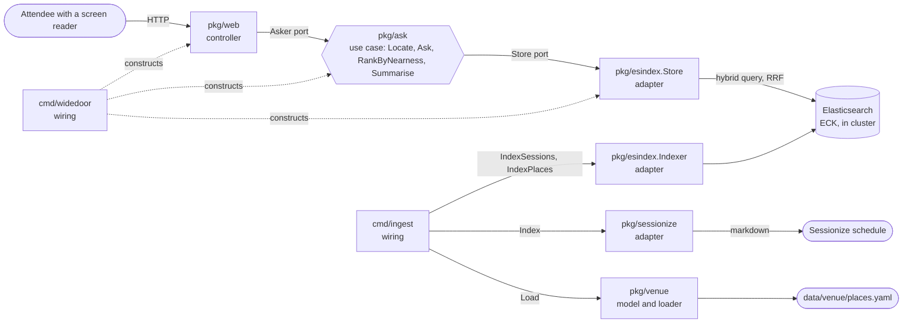

# Wide Door, how it is built

One Go module, four layers, every import pointing inward.
The use case in the middle says what it needs; everything around it either asks it questions or answers them.

## Packages, one line each

| package | layer | what it is for |
| --- | --- | --- |
| `pkg/ask` | use case, and the model types | answers "where is the nearest X from here": resolves the room, searches, ranks by level then building, writes the one sentence a screen reader hears first |
| `pkg/venue` | model | the curated access features (`data/venue/places.yaml`), the rooms derived from the schedule, and the loader that validates them |
| `pkg/esindex` | adapter | everything Elasticsearch: the HTTP client, `Store` (the hybrid BM25 plus `semantic_text` query fused with RRF, the room lookup, hit parsing) and `Indexer` (both index mappings, document shapes, bulk writes) |
| `pkg/sessionize` | adapter | fetches and parses the public KubeCon schedule from Sessionize's markdown view |
| `pkg/web` | controller | the HTML page, the JSON API, the probes, the templates and the CSS |
| `cmd/widedoor` | wiring | reads configuration, builds the Elasticsearch adapter, the use case and the web server, and runs it |
| `cmd/ingest` | wiring | reads configuration, fetches the schedule, loads the places, hands both to the indexer |

## Ports, one line each

| port | declared by | implemented by | why it exists |
| --- | --- | --- | --- |
| `ask.Store` (`LocateRoom`, `FindPlaces`, `FindSessions`) | `pkg/ask` | `esindex.Store` | the use case asks for rooms, places and sessions in its own words; the query language stays in the adapter, and `Ask` is tested with a ten-line fake |
| `web.Asker` (`Ask`, `Locate`) | `pkg/web` | `ask.Service` | the page needs answers, not a search engine; handler tests pass a fake |

Each port is declared by the package that uses it, not the one that implements it.
That is the whole trick: dependencies point at interfaces owned by the caller, so the caller never depends on the callee's implementation.

## Binaries, one line each

| binary | wires |
| --- | --- |
| `widedoor` | `esindex.Client` into `esindex.Store`, into `ask.Service`, into `web.New`, behind an `http.Server` on `LISTEN` |
| `ingest` | `sessionize.Client` and `venue.Load` on the read side, `esindex.Indexer` on the write side, with the schedule's locations turned into room documents in between |

## Where to look when

| you want to change | look in |
| --- | --- |
| how answers are ranked, or the sentence a screen reader hears | `pkg/ask` (`RankByNearness`, `Summarise`) |
| the Elasticsearch query, the retrievers, which fields are searched | `pkg/esindex/store.go` |
| what is indexed and how it is mapped | `pkg/sessionize` (what is fetched), `pkg/esindex/index.go` (mappings and document shapes) |
| the curated places or how "nearest" knows levels | `data/venue/places.yaml`, `pkg/venue` |
| the page, the form, the live region, the CSS | `pkg/web` |
| what runs in the cluster, probes, resources, routes | `deploy/app` (synced by Argo CD, pinned by image SHA, bumped by `tools/bump-image.sh` or by `cd.yml`) |
| how a release is built, pinned, checked and rolled back | `.github/workflows/cd.yml`, `tools/wait-pr.sh`, `tools/wait-rollout.sh`, `tools/smoke.sh`, ADR 0008 |
| the platform under it (gateway, ECK, Argo, Dash0, Radar) | `infra/platform` (Terraform, built before kickoff) |

## How a change reaches production

Two workflows, by design ([ADR 0008](adr/0008-ci-cd-separation-and-rollback-by-revert.md)): `ci.yml` is what the required checks run, on every PR and on `main`; `cd.yml` starts only when CI on `main` succeeds and never on a PR.
Every change to `main`, bumps and reverts included, arrives through a pull request, so `git log main` is the release history.
The gate runs as the `cd-gate` ServiceAccount, which can read rollouts, replicasets and pods in `wide-door` and nothing else; its kubeconfig is built by `infra/platform` and stored as a repository secret.
Radar watches the cluster the whole time and lists a stalled Rollout as a live issue, correlated to the change that caused it; [`docs/demo/2026-11-09-rollout-abort.md`](demo/2026-11-09-rollout-abort.md) is one such event, captured live.

## The rule, and the check

The rule is in [`.gitar/review/architecture.md`](../.gitar/review/architecture.md): model and use case import nothing from this module, adapters may import the model, controllers import use cases and adapters, and nobody imports a controller.
`tools/archcheck.sh` reads the import graph with `go list` and fails CI with the offending edge named, so the rule cannot drift from the code without a red check.
A new package has to be placed in a layer in that script and get a line on this page before CI goes green.
